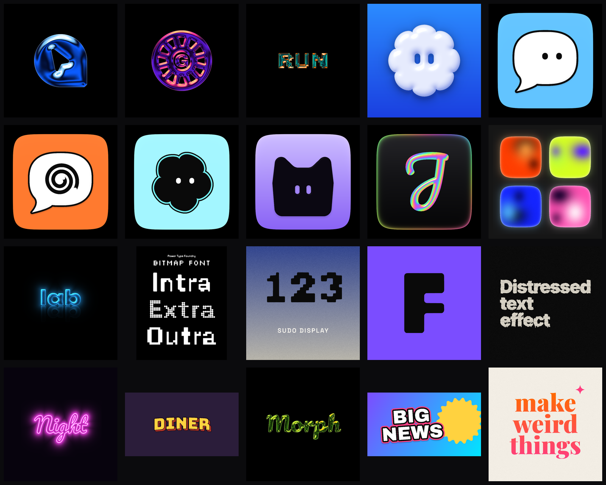
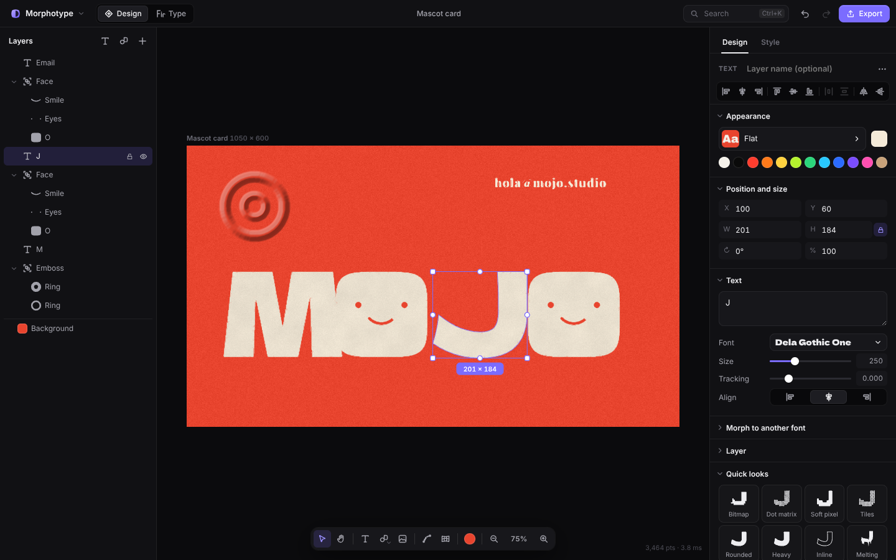
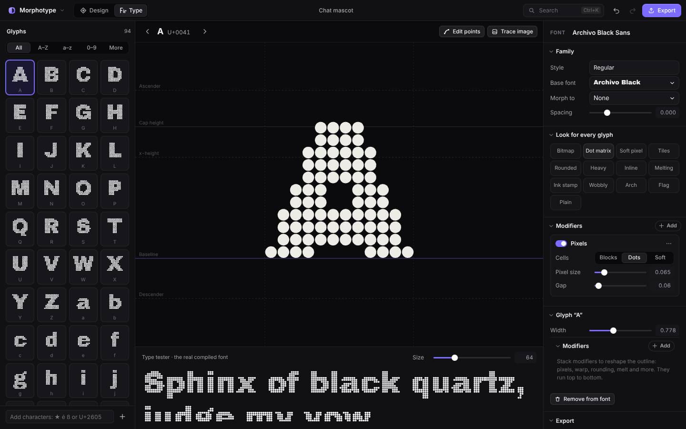

# Morphotype

A Mac-first type and logo lab. Morph one typeface into another, reshape lettering with a stack of modifiers, draw by hand, put photos inside any shape, trace images into vector marks, compile the result into a real installable font, and render it as liquid chrome, glow glass, puffy 3D, halftone, dither, rubber stamp or neon, all in real time on the GPU.



## Install

Download the latest `.dmg` from [Releases](https://github.com/srivtx/morphotype/releases). It's a universal app for Apple silicon and Intel Macs. Open it and drag **Morphotype** to Applications. The app isn't notarised yet, so the first time macOS blocks it: go to **System Settings → Privacy & Security** and click **Open Anyway**, or run `xattr -dr com.apple.quarantine /Applications/Morphotype.app` once in Terminal. `Morphotype-web.zip` in the same release is the browser version, ready to host anywhere.

## What it does

Morphotype has two modes: **Design** for logos, icons, thumbnails and posts, and **Type** for designing a whole font. **Home** lists every design and font you've made; they save on this device as you work.

**Design mode**
- **Type on the canvas.** Press T and click anywhere to type, or double-click any text to edit it in place, with a real caret and selection and a small bar for font, size, colour and alignment.
- **Pen tool.** Press P and draw like in Illustrator or Figma: click for corners, drag for curves, close on the first point for a filled shape, or finish open for a line with round, flat or square ends. Every point stays editable. Lines can carry a zigzag, wave, meander, coil or scallop along them (whole ridges per segment, round turns, flat ends), and dashes or dots.
- **Draw.** Press B for marker, pencil or highlighter strokes, with pen pressure and tapered ends. Drawings stay editable vector layers.
- **Photos.** Drop in a picture and place it inside any shape or text (zoom, pan, duotone, grain), trace it into an outline, or turn it into pixel art with a few inks and optional dithering.
- **Direct editing.** Click to select, drag to move, and use the handles to resize, stretch or rotate (⇧ keeps proportions, as in Figma). Smart guides snap to the artboard and other layers, hold ⌥ to measure distances, and drags show live readouts. Also marquee selection, multi-select, align and distribute, flip, lock, hide, groups and right-click menus.
- **A material per layer.** Liquid chrome, Glow glass, Puffy, Sticker, Aura gradient, Holographic, Retro 3D, Neon, Glossy glyph, Distressed (with rubber-stamp grain), Letterpress, Halftone (with 3D light and misregistration), Risograph, Dither, Photo, Thermal, Prism light, Colour dots, Plush, Pattern (twenty GPU patterns, from sunbursts and Truchet arcs to houndstooth and op-art), Ribbon (colour that flows along a line) and Flat with linear or radial gradients, print texture and hard shadows. **Frosted glass** and **Lens glass** see what's behind them: they blur, bend, magnify and split it into colour. There are over 70 presets with GPU-rendered previews, and the Design tab recolours any material from a single colour. Every layer can also have a stroke (outside, centre or inside), solid 3D **depth**, opacity and a Multiply or Screen blend.
- **Shapes that work like a logo tool.** Cut and Mask clip into the layer directly below, Merge fuses layers into one outline with one material, and Break apart splits text or traced images into one layer per letter.
- **Reshape anything.** Quick looks (Bitmap, Sun rays, Blob dots, Echo stack, Fused band, All the way round…) apply a whole modifier stack in one click. Warp gives Photoshop-style envelope presets plus 16 draggable points. Edit points gives real bezier editing. The modifiers are Weight, Round, Outline, Pixels (blocks, dots, soft tiles, crosses, pluses, diamonds, dissolve), Slice, Fuse, Foam, Repeat (around, grid, trail), Echo lines, Slant, Stretch, Warp, Fit in circle, Isometric, Arc (up to a full circle), Wave, Perspective, Wobble, Melt and Ink bleed.
- **Construction sheets.** Draw construction turns a logo into a presentation drawing: tinted outline, anchor markers and guides at its edges and the font's metric lines.
- **Shapes.** Circles to squircles, stars, sparkles, bursts, wavy and scalloped badges, globes, asterisks, lenses, clouds, folders, quarter and half circles, mascot bodies, eyes and smiles, all parametric.
- **Backgrounds and formats.** Solid, linear, radial or aura mesh gradients, film grain, patterns (grid paper, dot grid, lines, stripes, checks, doodles), and an app-icon tile with gloss, shadow and a holographic rim, set up for macOS (rounded tile in the artwork) or iOS and Android (full square, with a preview of the system mask), plus an app-icon grid as an overlay or as layers. The background is the bottom row in Layers and a chip in the dock. Canvas presets cover Instagram, Stories, YouTube thumbnails, X headers, OG images, app icons, business cards, ID badges and more.
- **Fonts.** TTF, OTF, TTC and WOFF, shaped with a HarfBuzz port, with variable axes. Text can morph into another font glyph by glyph.
- **Image tracing.** PNG, JPG, WebP or SVG become smooth vector outlines, or keep hard pixel edges. Colour tracing turns a flat logo into one editable vector layer per colour, and a picture can sit under your work as a locked reference to trace with the pen (never exported).

**Type mode**
- Start a font by naming it and picking a typeface to reshape, or start blank and draw every glyph over a guide.
- Type basics: a short guide to cap height, x-height, spacing, optical tricks and naming, plus clickable metric lines in the glyph editor.
- A glyph grid (A–Z, a–z, 0–9, punctuation and any character you add), previewed with your style.
- Font-wide looks and modifiers, per-glyph point editing, widths and modifiers, and tracing images into glyphs.
- Glyph layers: build glyphs from shapes and other glyphs (components), cut with them, give a glyph its own look, or bake the finished glyph into editable points.
- A live tester using the real compiled font.
- Export as `.ttf`, `.woff`, or a **web font kit** (TTF, WOFF, `@font-face` CSS and a specimen page). On the Mac app you can also install the font, and **Use in Design** adds it to your fonts under its own name, with a summary of how it differs from the font it started from.

**Export**: PNG at 1×, 2× or 4× (optionally transparent), JPG, copy to clipboard, SVG with one path per object, fonts, and `.morpho` project files that embed imported fonts.

**Keyboard first**: ⌘K searches every command, shape, preset, canvas size and setting. Every action has a shortcut (press ? in the app), and settings are searchable (⌘,).






## How it's built

```
┌──────────────────────── Mac app (Tauri) ────────────────────────┐
│  React UI ──► Web Worker ──► morpho-core (Rust → WebAssembly)   │
│     │                          fonts · morph · modifiers ·      │
│     │                          booleans · tracing · TTF writer  │
│     ▼                                                           │
│  WebGL2 renderer: mask → jump-flood SDF → height map → effect   │
│                                                                 │
│  Native side (Rust): system fonts · font install · dialogs      │
└─────────────────────────────────────────────────────────────────┘
```

- **One Rust engine, everywhere.** `crates/morpho-core` is pure Rust with no platform code. It runs as WebAssembly inside a Web Worker on both the Mac app and the web, so slider drags never pay an IPC round-trip and never block the UI thread. The same crate is linked natively into the Tauri shell.
- **Robust geometry.** Weight, rounding, outlines, ink and booleans all go through one path: narrow-band exact signed distance, then marching-squares iso-contours. Overlapping strokes merge correctly, nothing self-intersects, and the source font's winding rules don't matter.
- **GPU effects.** The outline is rasterised once. A jump-flooding pass builds a signed distance field in about 12 GPU passes, which is blurred into a height map. Each effect is a single fragment shader over those textures, so changing a colour or bevel redraws in under a frame.
- **Latest-wins scheduling.** While the engine is busy, only the newest document is queued. If the WebAssembly module ever traps, the worker restarts, reloads fonts and retries.
- **Small native app.** Tauri uses the system WKWebView rather than bundling Chromium.

Typical timings (release build, a 10-letter word): plain text under 0.5 ms, weight about 5 ms, rounding about 20 ms, ink about 25 ms, slice about 10 ms. A 2000-point brush scribble takes about 5 ms and seven echo rings around a shape about 11 ms. Cached rebuilds when only another layer changed take about 0.3 ms. See `cargo run --release -p morpho-core --example bench`.

More detail is in [docs/ARCHITECTURE.md](docs/ARCHITECTURE.md).

## Getting started

Prerequisites: Rust (stable), Node 22, and the WebAssembly toolchain:

```sh
rustup target add wasm32-unknown-unknown
cargo install wasm-bindgen-cli --version 0.2.129
npm install
```

| Task | Command |
| --- | --- |
| Run in the browser | `npm run dev`, then open http://localhost:1420 |
| Run the Mac app | `npm run tauri dev` |
| Build the Mac app (.app and .dmg) | `npm run tauri build` (universal binary: add `-- --target universal-apple-darwin`) |
| Build the web app | `npm run build` (output in `dist/`) |
| Rust and UI unit tests | `npm test` |
| Browser end-to-end test | `npm run build && npm run test:e2e` |

CI builds an unsigned universal `.dmg` on every push to `main` (the *Morphotype-macOS* artifact). The first build of a new version (the `version` in `package.json`) on `main` also publishes a GitHub Release with the `.dmg` and the web build attached.

### Shortcuts

| | |
| --- | --- |
| ⌘K | Search every command |
| V / H / T / B / O / R | Select, hand, text tool, draw, circle, squircle |
| [ / ] | Smaller / bigger brush |
| Enter / ⇧Enter | Edit the selected text or enter a group / select the parent group |
| Hold ⌥ | Measure distances from the selection |
| P / W | Edit points / warp |
| ⌘G / ⇧⌘G / ⇧⌘M | Group / ungroup / merge into one shape |
| ⌥A ⌥H ⌥D / ⌥W ⌥V ⌥S | Align left, centre, right / top, middle, bottom |
| ⌘] ⌘[ (⌥ for front/back) | Bring forward / send backward |
| ⇧⌘B / ⌥⌘O | Break apart / convert to outline |
| ⌘D, ⌘C, ⌘V, ⌥⌘C, ⌥⌘V | Duplicate, copy, paste, copy style, paste style |
| ⌘E / ⇧⌘E / ⇧⌘C | Export PNG / SVG / copy image |
| ⌘1 / ⌘2 | Design / Type mode |
| ⌘0, ⇧0, ⇧2 | Fit, 100%, zoom to selection |
| ⌘' / ⇧⌘' | Show grid / snap to grid |
| Arrows (⇧ for 10 px), Tab | Nudge, cycle layers |
| ? / ⌘, | Help and all shortcuts / settings |

Drag fonts, images or `.morpho` files onto the window to open them.

## Repository layout

```
crates/morpho-core   Rust engine (geometry, fonts, morph, modifiers, trace, TTF/SVG)
crates/morpho-wasm   wasm-bindgen bindings
src-tauri            Mac/desktop shell: system fonts, font install, dialogs
ui/src/engine        Worker + client for the engine
ui/src/render        WebGL2 renderer, SDF passes and effect shaders
ui/src/components    Editor UI
ui/public/fonts      Bundled OFL fonts
scripts              WASM build and end-to-end test
```

## Fonts and licences

The code is MIT licensed. The bundled fonts (Archivo Black, Inter, Space Grotesk, Playfair Display, Rubik Mono One, Pacifico, Silkscreen, Unbounded, Bungee, Dela Gothic One, Young Serif, Bricolage Grotesque, Caveat, Caveat Brush) are under the SIL Open Font License; see `ui/public/fonts/OFL.txt`. A font you make from an OFL font is a derivative: give it a new family name and keep it under the OFL.

## Known limitations

- Exported fonts don't carry kerning or OpenType features yet; metrics come from the base font(s).
- Content outside the artboard isn't rendered (like a clipped frame), though you can still select and move it.
- WOFF2 imports aren't supported yet; import the TTF or OTF instead.
- Morphing between structurally very different glyphs, such as a two-storey and a single-storey "a", can pinch mid-way. Moving the blend toward either end resolves it.
- The renderer needs WebGL2 with float render targets (`EXT_color_buffer_float`), which WKWebView provides on macOS 12 and later. If it's missing, editing and SVG/font export still work but the effect preview doesn't.
